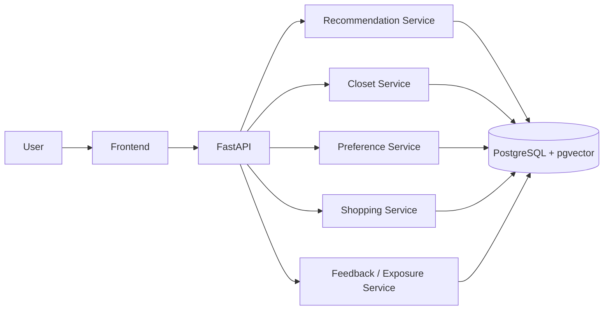
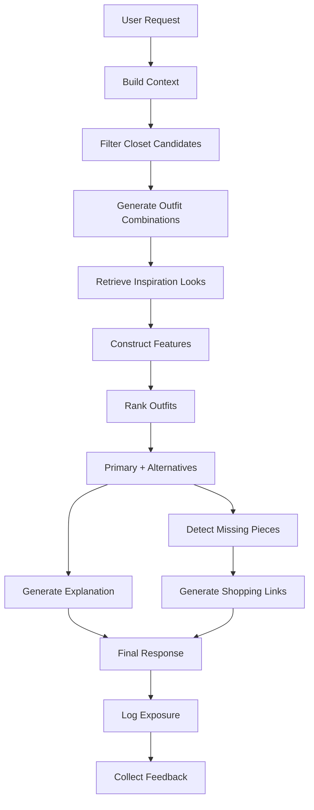

# AI Closet Stylist Agent

An AI-powered personal styling system that generates daily outfit recommendations from a user’s own wardrobe, combining wardrobe retrieval, weather-aware filtering, preference modeling, outfit ranking, and shopping suggestions for missing pieces.

---

## Highlights
- Build a **digital closet** from user-uploaded clothing images
- Generate **daily outfit recommendations**
- Return **alternative outfit options**
- Learn user taste through **feedback and interaction history**
- Suggest **missing pieces** with shopping search links
- Support future **ranking experiments** and **model retraining**

---

## Problem
Most fashion recommendation products focus on new products instead of helping users make better use of the clothes they already own.

This project solves:
- what to wear today,
- how to avoid repetitive outfits,
- how to align recommendations with weather and occasion,
- and what to buy when the wardrobe is missing key items.

---

## Core Features

### 1. Closet Ingestion
- clothing image upload
- auto-tagging and metadata extraction
- persistent online wardrobe storage

### 2. Preference Modeling
- explicit preference setup
- implicit behavior learning
- style / color / warmth preference updates

### 3. Outfit Retrieval
- weather and occasion filtering
- wardrobe candidate retrieval
- inspiration look retrieval with embeddings

### 4. Outfit Ranking
- multi-factor outfit scoring
- primary recommendation + alternatives
- future model-based ranking support

### 5. Shopping Suggestion
- missing piece detection
- reason generation
- store search links

### 6. Feedback Loop
- like / dislike / skip / save
- exposure logging
- training data generation
- iterative personalization

---

## Tech Stack

### Frontend
- Next.js
- TypeScript
- Tailwind CSS
- shadcn/ui

### Backend
- FastAPI
- Python
- Pydantic
- SQLAlchemy / SQLModel

### Data
- PostgreSQL
- pgvector
- Object Storage (Supabase Storage)

### AI / ML
- CLIP / FashionCLIP
- Sentence Transformers
- LLM for explanation generation
- LightGBM / XGBoost for future ranking

---

## System Architecture



---

## Recommendation Pipeline



---

## Database Design
This project uses the following main tables:
- `users`
- `closet_items`
- `user_preferences`
- `feedback`
- `events_raw`
- `model_registry`
- `recommendation_exposures`
- `outfit_images`
- `outfit_image_embeddings`
- `outfit_style_embeddings`
- `outfit_text_embeddings`

The schema supports:
- multi-user isolation,
- recommendation observability,
- A/B testing,
- ranker versioning,
- and vector retrieval.

---

## API Scope

### Users
- `POST /users`
- `GET /users/{user_id}`
- `PATCH /users/{user_id}/profile`

### Closet
- `POST /closet-items/upload`
- `GET /users/{user_id}/closet-items`
- `PATCH /closet-items/{item_id}`
- `DELETE /closet-items/{item_id}`

### Recommendations
- `POST /recommendations/today`
- `GET /recommendations/history`

### Feedback
- `POST /feedback`
- `POST /events`

---

## MVP Scope
Included:
- wardrobe upload
- preference setup
- daily outfit recommendation
- alternative outfits
- shopping link generation
- feedback logging

Not included:
- social sharing
- affiliate monetization
- virtual try-on
- advanced conversational stylist agent

---

## Example Recommendation Logic

```python
score = (
    0.28 * style_match +
    0.22 * weather_fit +
    0.18 * occasion_fit +
    0.12 * color_harmony +
    0.10 * user_preference +
    0.06 * novelty +
    0.04 * closet_utilization
)
```

---

## Portfolio Value
This project demonstrates:
- applied AI product design
- multimodal retrieval
- recommendation system thinking
- full-stack engineering
- experimentation-ready backend design
- production-style logging and model lifecycle awareness

---

## Roadmap
- calendar-aware recommendation
- scheduled push notifications
- ranker retraining jobs
- shopping API integration
- wardrobe analytics dashboard
- conversational personal stylist agent
